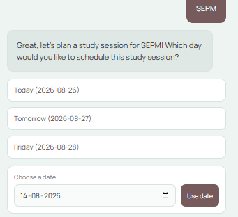
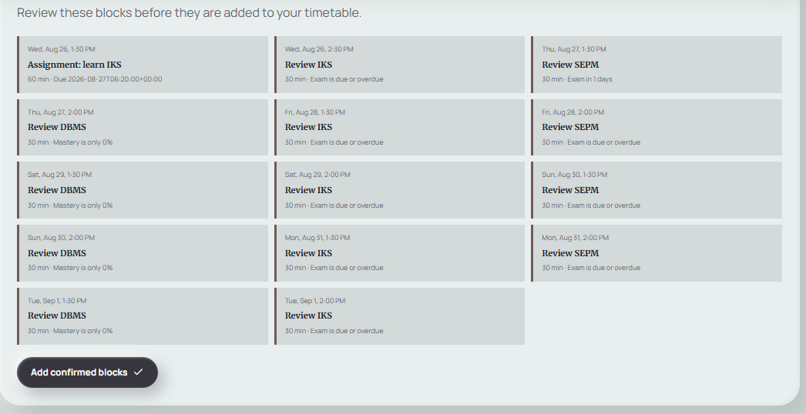
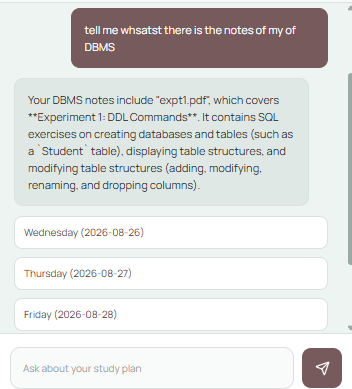
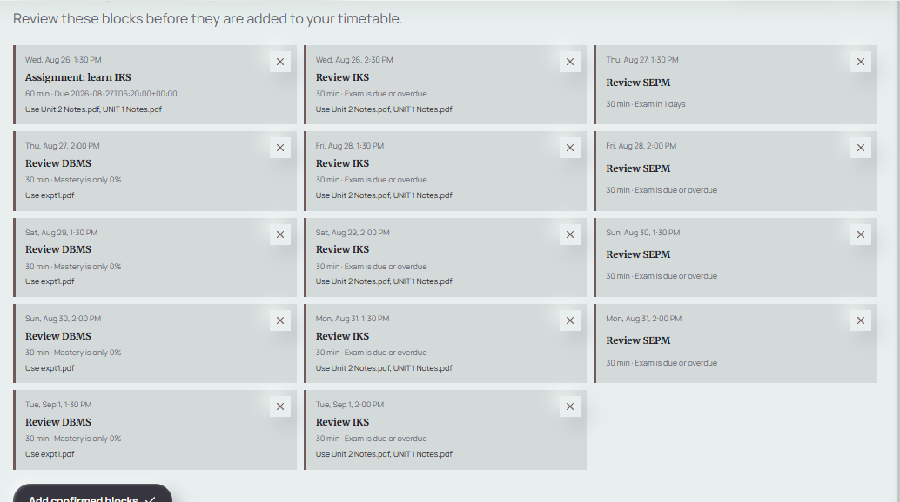
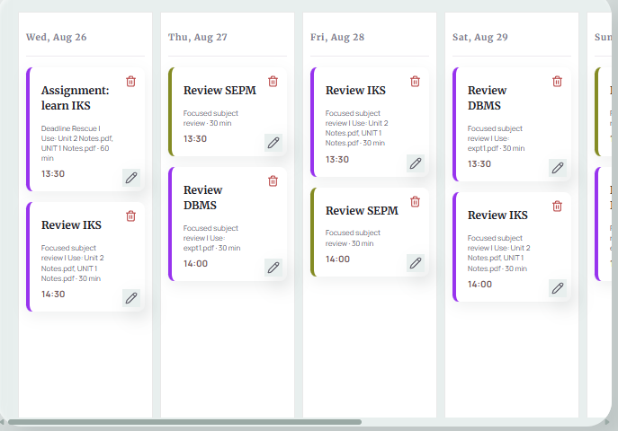

# RISE 🚀

RISE is an intelligent, AI-powered study engine designed to help users create adaptive learning plans, process multi-modal educational content, and enforce distraction-free study sessions. 

The platform consists of a **React/Vite Frontend**, a **Django REST API Backend**, and a **Chrome Extension** (Focus Guard) to maintain productivity.

## 🌟 Key Features

- **🧠 Adaptive Study Plans:** Uses advanced AI (OpenAI) to generate custom, personalized study plans based on your materials.
- **🔒 Focus Guard (Chrome Extension):** Enforces study sessions by blocking distracting websites. Want a break? You'll need to answer "Smart Break" questions to temporarily unlock navigation.
- **📄 Multi-Modal Content Processing:** 
  - Parse and extract text from PDFs, DOCX, and PPTX files.
  - Fetch and process transcripts directly from YouTube videos.
  - Extract text from images using built-in OCR (Optical Character Recognition).
- **📊 Progress Analytics:** Visualizes your study metrics and progress using beautiful, interactive charts.
- **🔐 Secure Authentication:** Seamless and secure login using JWT and Google OAuth.

## 💻 Technologies Used

### Frontend
- **Core Framework:** [React 19](https://react.dev/) & [Vite](https://vitejs.dev/)
- **Styling:** [Tailwind CSS](https://tailwindcss.com/)
- **Animations:** [Framer Motion](https://www.framer.com/motion/)
- **Data Visualization:** [Recharts](https://recharts.org/)
- **Client-Side Processing:** PDF.js (Documents), Tesseract.js (OCR)
- **Integrations:** Firebase

### Backend
- **Core Framework:** [Django 6.0](https://www.djangoproject.com/) & [Django REST Framework](https://www.django-rest-framework.org/)
- **Database:** PostgreSQL (Production) / SQLite (Development)
- **AI Engine:** [OpenAI API](https://openai.com/)
- **Document Parsing:** PyPDF, python-docx, python-pptx, pytesseract
- **Media Processing:** youtube-transcript-api, yt-dlp, Pillow, imageio-ffmpeg
- **Authentication:** SimpleJWT, Google Auth, OAuthlib

### Extension (Focus Guard)
- **Architecture:** Chrome Manifest V3
- **Functionality:** Communicates with the RISE backend via a background service worker to block unwanted HTTP/HTTPS navigation during active study sessions, acting as a strict productivity enforcer.

## 📸 Screenshots

### Adaptive Plan UI






## 🚀 Getting Started

For a more detailed setup instruction (including environment variables and testing), please check out our comprehensive **[Run Guide](runreadme.md)**.

### Prerequisites
- Python 3.13 or later
- Node.js and npm
- Windows PowerShell (for the provided scripts)

### Quick Start (Development)

**1. Start the Backend:**
Open a PowerShell terminal and run:
```powershell
cd backend
py -3.13 -m venv ..\..\.venv
..\..\.venv\Scripts\python.exe -m pip install -r requirements.txt
..\..\.venv\Scripts\python.exe manage.py migrate
..\..\.venv\Scripts\python.exe manage.py runserver
```
*The API will be available at `http://127.0.0.1:8000/`.*

**2. Start the Frontend:**
Open a second PowerShell terminal and run:
```powershell
cd frontend
npm install
npm run dev
```
*The Frontend will be available at `http://localhost:5173/`.*

**3. Load the Extension:**
- Open Google Chrome and navigate to `chrome://extensions`.
- Enable **Developer mode** in the top right.
- Click **Load unpacked** and select the `extension` folder from this repository.
- Make sure to sign in to RISE locally to sync your session with the extension!

---
*Built with focus and productivity in mind.*
